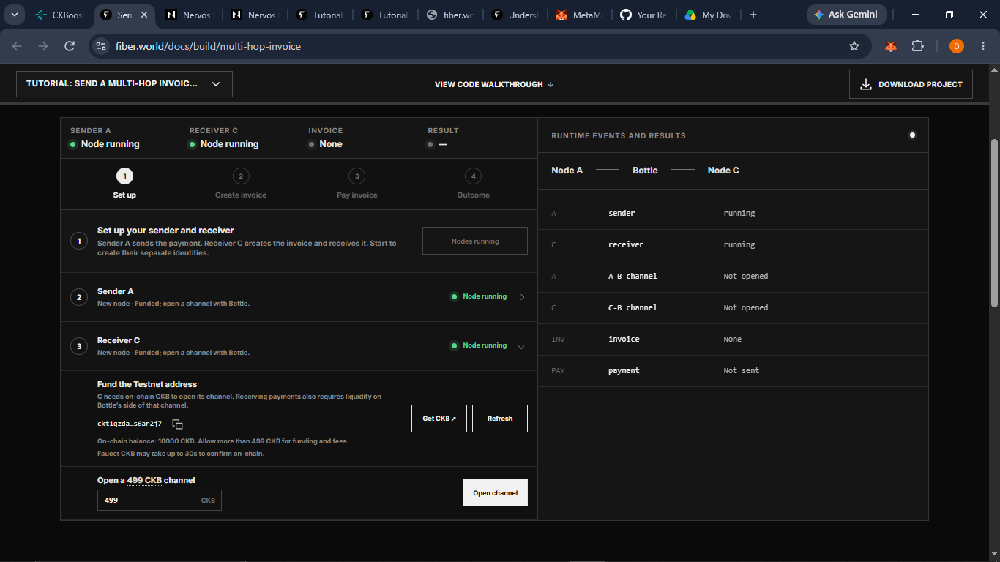
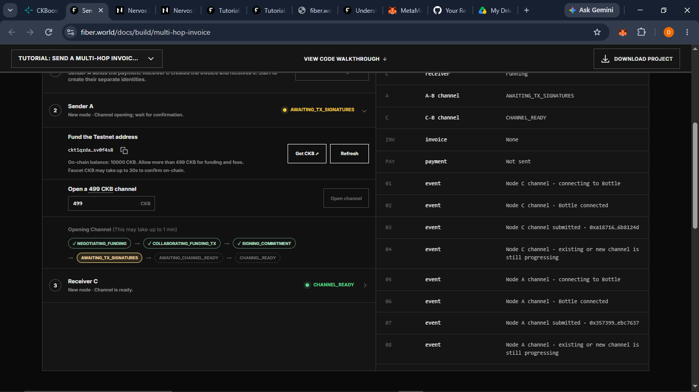
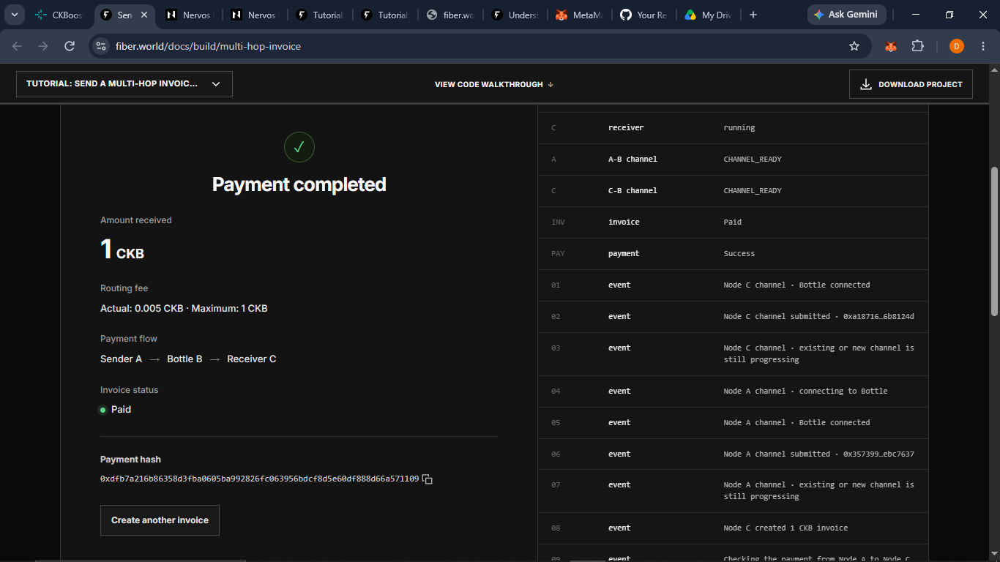
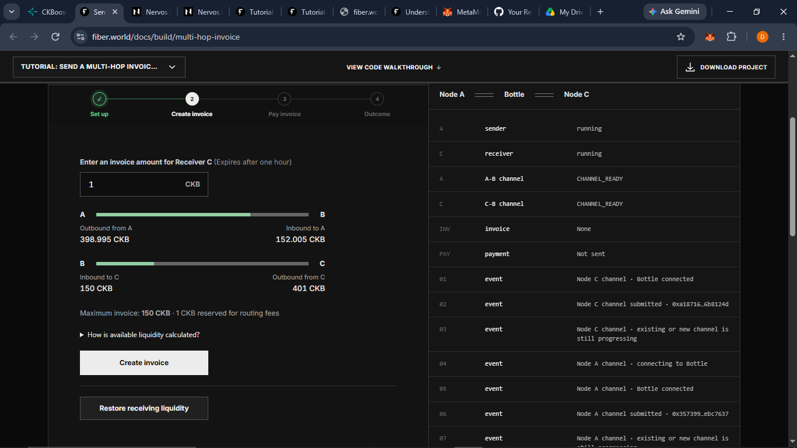
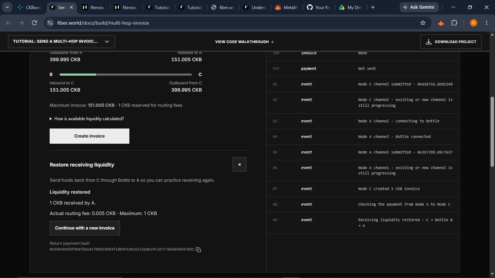
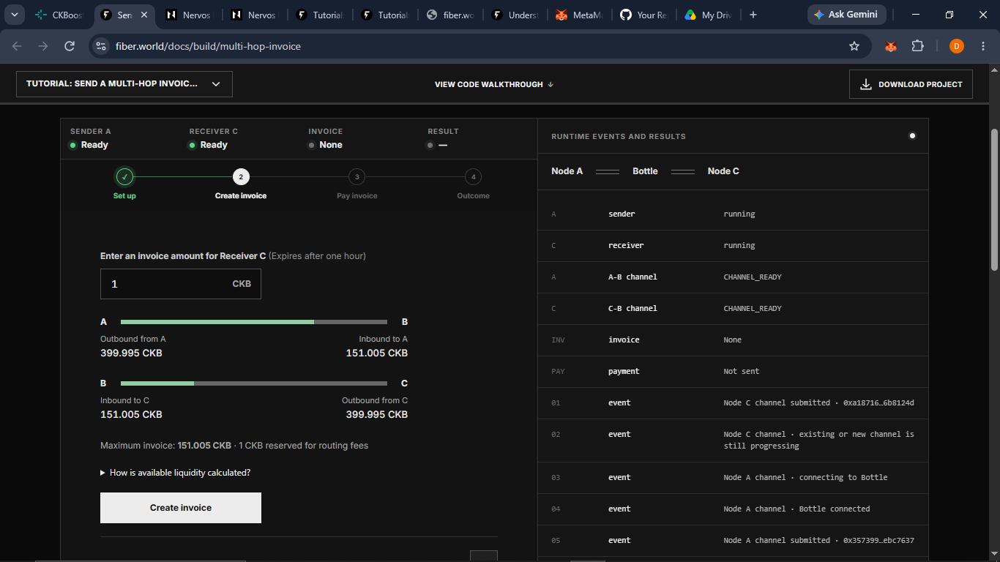

# Build on CKB Campaign #7: Send Your First Multi-Hop Payment with Fiber

This repo is my proof of completion for **Build on CKB Campaign #7** on CKBoost.

In this campaign I ran two Fiber nodes in my browser, Sender A and Receiver C,
and sent a real Testnet payment between them through **Bottle B**, a public
node that forwards payments. After that, I sent the payment back the other way
to restore C's ability to receive.

- **Tutorial:** [Send a Multi-Hop Invoice Payment](https://www.fiber.world/docs/build/multi-hop-invoice)
- **Version used:** Hosted live demo in the browser
- **Network:** CKB Testnet only

## Results

| | Route | Amount | Actual fee | Payment hash |
|---|---|---|---|---|
| Quest 1 | A → Bottle B → C | 1 CKB | 0.005 CKB | `0xdfb7a216b86358d3fba0605ba992826fc063956bdcf8d5e60df888d66a571109` |
| Quest 2 | C → Bottle B → A | 1 CKB | 0.005 CKB | `0x18b46e98fd9af8a1a17b9d3d964f1db941de16232eab29c2e7c7668849843892` |

## What I did

### 1. Set up two browser nodes
I started Sender A and Receiver C in the tutorial. Each node got its own
identity, keys, storage and Testnet funding address.

### 2. Funded both nodes and opened channels with Bottle
I funded each node from the CKB Testnet faucet. Then I opened a 499 CKB public
channel from each node to Bottle and waited until both showed CHANNEL_READY.

### 3. Checked the starting liquidity
Once both channels were ready, the maximum invoice I could create was **151 CKB**.

### 4. Quest 1: A → Bottle B → C
Receiver C created a 1 CKB invoice and Sender A paid it through Bottle.

### 5. Quest 2: Restored receiving liquidity (C → Bottle B → A)

**Before the reverse payment:**

**Liquidity restored:**

**After the reverse payment:**

## My liquidity numbers

All amounts are in CKB and come from my screenshots.

| Channel side | Start | After Quest 1 | After Quest 2 |
|---|---|---|---|
| A-B: Outbound from A (A's side) | 400 | 398.995 | 399.995 |
| A-B: Inbound to A (Bottle's side) | 151 | 152.005 | 151.005 |
| B-C: Inbound to C (Bottle's side) | 151 | 150 | 151.005 |
| B-C: Outbound from C (C's side) | 400 | 401 | 399.995 |
| **Maximum invoice** | 151 | 150 | 151.005 |

Both channels add up to 551 CKB in every column.

## How the reverse payment changed liquidity

### The B-C channel
Before the reverse payment, C had 401 CKB on its side and Bottle had 150 CKB on
its side. Afterwards, C had 399.995 CKB and Bottle had 151.005 CKB.

C's side went down by 1.005 CKB because this time C was the one paying. C sent
the 1 CKB going back to A plus Bottle's 0.005 CKB fee, and all of that moved
from C's side of the channel to Bottle's side.

### The A-B channel
Bottle's side went from 152.005 to 151.005 CKB, and A's side went from 398.995
to 399.995 CKB.

That's because Bottle passed the payment on. It moved exactly 1 CKB from its
side of the A-B channel to A, and kept the 0.005 CKB fee it had picked up in
the B-C channel. Each channel only shifts money between its own two sides, so
Bottle's two channels moved in opposite directions.

### Why "Inbound to C" matters
C had 401 CKB on its own side, but that's only what C can send. What C can
receive depends on how much Bottle holds on its side of the B-C channel,
because Bottle is the one that has to move money over to C.

I could see this in the maximum invoice. It was 150 CKB before the reverse
payment and 151.005 CKB after. The restore panel showed the same idea from the
other direction: the maximum return was 152.005 CKB, exactly the same as
"Inbound to A". A was the receiver this time, so A could only get as much as
Bottle held on its side of the A-B channel.

### Fees
Each payment cost 0.005 CKB in routing fees, with a maximum of 1 CKB allowed.

In Quest 1, A paid 1.005 CKB and C received exactly 1 CKB. In Quest 2, C paid
1.005 CKB and A received 1 CKB. The difference went to Bottle for forwarding
both payments, so Bottle earned 0.01 CKB in total.

By the end, A and C each had 399.995 CKB instead of 400, and Bottle's side had
grown to 151.005 CKB in both channels. Each channel still added up to 551 CKB.
So off-chain payments don't create or destroy CKB. They just change how a
channel's fixed amount is split between the two sides.

I was surprised the fee was only 0.005 CKB when the maximum was 1 CKB. My
understanding is that the 1 CKB is a budget the sender allows on top of the
invoice amount, not what they'll definitely pay. 0.005 CKB is what this route
actually charged. The tutorial does say trampoline routing can use up to the
full budget, though, so a low fee isn't guaranteed.

### Reserve vs. fee
Each channel was funded with 499 CKB, but only 400 CKB showed as available.
That's because 99 CKB is held back for settling the channel on-chain: 98 CKB
for the commitment lock's on-chain storage and 1 CKB for the transaction fee
when the channel closes. That 99 CKB can't be used for payments.

The reserve isn't the same as a routing fee. Nobody gets paid the reserve.
Most of it comes back to the owner when the channel closes, and about 1 CKB
goes toward the closing transaction fee. A routing fee, on the other hand, goes
to the node that forwards the payment, and you don't get it back.

Bottle's 151 CKB fits the same pattern if Bottle put in 250 CKB
(250 minus 99 is 151), but I couldn't confirm how much Bottle actually funded.

## Challenges I ran into

### 1. My two channels didn't become ready at the same time
**What I expected:** I thought both channels would be ready at about the same time.

**What happened:** C's channel reached CHANNEL_READY while A's channel was still
stuck at AWAITING_TX_SIGNATURES. I wanted to click Open channel again, but the
button was greyed out while the channel was opening.

**How I sorted it out:** I didn't try to reopen it. I left the page open and
waited while A's channel went through NEGOTIATING_FUNDING,
COLLABORATING_FUNDING_TX, SIGNING_COMMITMENT, AWAITING_TX_SIGNATURES,
AWAITING_CHANNEL_READY and finally CHANNEL_READY. It took about 1 to 2 minutes.
Then I realised the two channels are separate on-chain funding transactions,
opened one after the other, so each one needs its own confirmation. C's
started first, so it finished first.

### 2. The event log didn't match the channel status
**What I expected:** I thought the event log would add a "channel ready" entry
once each channel opened, like the status rows above it.

**What happened:** The log still said "existing or new channel is still
progressing" even after both channels showed CHANNEL_READY.

**How I sorted it out:** I went with the status rows, which both said
CHANNEL_READY, the green "Ready" badges, and the fact that Step 2 (Create
invoice) had unlocked. That's when I understood the log only records an event
when it happens and doesn't add one when a channel finishes opening. A
"channel ready" entry in the log would stop beginners from thinking their
channel is stuck.

### 3. Reading the liquidity bars
**What I expected:** I thought each bar would only show my own node's balance.

**What happened:** At first I wasn't sure which side of each bar was Bottle's.

**How I sorted it out:** I read the labels under each bar. "Outbound from A"
and "Outbound from C" are my nodes' sides. "Inbound to A" and "Inbound to C"
are Bottle's sides, because inbound means what the other side holds and can
send to me. I double checked after the first payment: "Inbound to C" dropped
from 151 to 150 and "Outbound from C" went up from 400 to 401, so the money had
moved from Bottle's side to C's.

## Reflection

### What I learned about liquidity on the A-B and B-C channels
Before this tutorial, I thought the CKB I had in a channel was also how much I
could receive. But in my run, A had 400 CKB available and the maximum invoice
was still only 151 CKB, because Bottle only had 151 CKB on its side toward C.

That showed me sending and receiving depend on different balances. My own
balance is what I can send. What I can receive depends on what the other side
of the channel holds. In a multi-hop payment, the smallest balance along the
route, in the direction the payment is going, sets the limit. In my case that
was Bottle's side of the B-C channel, not A's 400 CKB.

### Why multi-hop payments are useful
A and C never opened a channel with each other, but A still paid C's invoice
through Bottle in a few seconds, for a 0.005 CKB fee and with no new on-chain
transaction.

That matters because every channel needs an on-chain transaction and locks up
CKB, including the 99 CKB reserve. With multi-hop payments you don't need a
channel with everyone you want to pay. One channel to a well connected node
like Bottle is enough to reach other people.

### What I found unexpected and interesting
The thing that surprised me most was that after C got paid, C could receive
less than before. The maximum invoice dropped from 151 CKB to 150 CKB even
though C now had more CKB. It only made sense once I saw that receiving uses up
the inbound side of the channel, which is why I had to send 1 CKB back through
Bottle to restore it.

I also found it interesting that each channel still added up to exactly 551 CKB
after every payment. The payments only moved money from one side to the other,
and Bottle earned its fees without either channel's total changing.

## Feedback on the tutorial

### 1. Show clearer progress while a channel is opening
C's channel was already ready, but A's sat at AWAITING_TX_SIGNATURES for about
1 to 2 minutes, and I had no idea whether that was normal or whether it was
stuck. I wanted to click Open channel again. The button was greyed out, but
nothing told me the wait was normal.

Even after both channels were ready, the event log still said "existing or new
channel is still progressing". It would help to add a "channel ready" entry to
the log when each channel finishes opening. It would also help to show how long
the current stage has been running, with a short note like "Waiting for on-chain
confirmation. This is normal, don't reopen."

### 2. Make it clearer which side of each bar belongs to Bottle
When I first saw the liquidity bars, I thought each one only showed my node's
balance. The bars have A, B and C at the ends, but I wasn't sure at first that
B meant Bottle, or which side was Bottle's. I figured it out from the
"Outbound from" and "Inbound to" labels and by watching the numbers change
after the payment.

It would help if the ends of each bar said "A (you)" and "Bottle" instead of
single letters, plus a one line note saying that inbound means what Bottle
holds on its side and can send to you.

### 3. Explain the 1 CKB fee budget on the Pay invoice step
When I saw "Max. routing fee: 1 CKB" before paying, I expected the fee to be
around 1 CKB. The actual fee was only 0.005 CKB.

It would help to explain, right next to the 1 CKB, that this is the most the
sender is willing to pay on top of the amount, not the fee they'll actually be
charged. It could also mention that the real fee shows up after the payment,
and that trampoline routing can use up to the full budget.

## Safety note

Everything here used **Testnet CKB only**. No private keys, seed phrases,
passwords or browser storage data are included in this repo.

## References
- [Send a Multi-Hop Invoice Payment](https://www.fiber.world/docs/build/multi-hop-invoice)
- [Multi-Hop Payments](https://www.fiber.world/docs/concept/routing/multi-hop)
- [Understanding Fiber Liquidity](https://www.fiber.world/docs/concept/liquidity/overview)
- [Open a Fiber Channel and Send a Payment](https://www.fiber.world/docs/build/open-channel-payment)
- [Connect to Fiber with a WASM Node](https://www.fiber.world/docs/build/connect-wasm-node)
